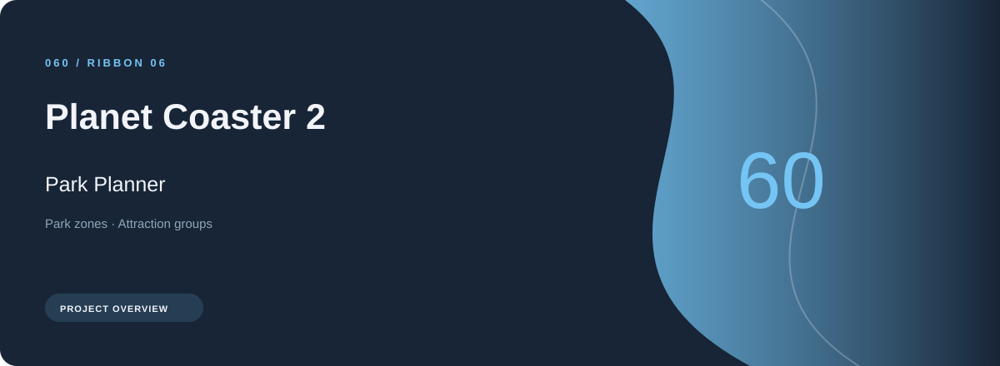
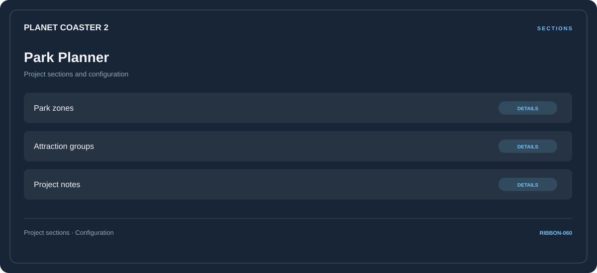

# 🛠️ Planet Coaster 2 Park Planner

**Park zones · Attraction groups · Project notes**

## ⚡ Features

A task-oriented Planet Coaster 2 park planner workspace: park zones first, attraction groups next, and project notes as the final reference area.

### ⚙️ Park zones

A dedicated section for park zones and the configuration details associated with that area.

### 🧩 Attraction groups

A dedicated section for attraction groups and the configuration details associated with that area.

### ⌨️ Project notes

A dedicated section for project notes and the configuration details associated with that area.

## 🖥️ Project navigation

## 📥 Download

The button and cover open the project's download page. Use the information supplied with the downloaded package for installation and release-specific requirements.

## 📚 Project documentation

- [Feature reference](docs/FEATURES.md)
- [Download information](docs/DOWNLOAD.md)
- [Project page](index.html)

---

Planet Coaster 2 Park Planner · Program documentation and download information.
